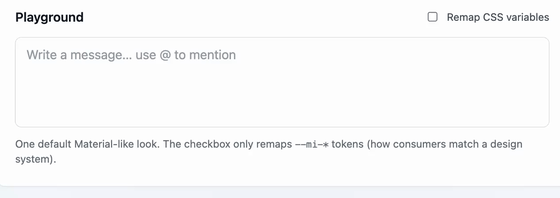

# mention-input

Professional contenteditable **`@mention`** input — structured chips + sections, not a plain textarea autocomplete.

| Package | Status |
|---------|--------|
| [`@mojsica/angular-mention-input`](./projects/angular-mention-input) | Ready |
| [`@mojsica/react-mention-input`](./packages/react-mention-input) | Ready |
| [`@mojsica/vue-mention-input`](./packages/vue-mention-input) | Ready |
| [`@mojsica/mention-core`](./packages/mention-core) | Private workspace (bundled into UI packages) |



**Angular gap:** existing Angular mention libs are mostly textarea/input `@`-autocomplete. Here you get a contenteditable field with mention chips, `MentionContentSection[]` value, CVA, CSS-variable theming, and demos — with the same product shape on React and Vue via shared core.

## Try demos

```bash
pnpm install
pnpm build:core

# Angular
pnpm start:angular
# http://localhost:4200

# React
pnpm start:react
# http://localhost:5173

# Vue
pnpm start:vue
# http://localhost:5174
```

## Install (when published)

```bash
npm i @mojsica/angular-mention-input
npm i @mojsica/react-mention-input
npm i @mojsica/vue-mention-input
```

### Angular

```html
<lib-mention-input
  formControlName="sections"
  [users]="users"
  [loading]="loading"
  (mentionQueryChange)="onQuery($event)"
/>
```

### React

```tsx
import { MentionInput } from '@mojsica/react-mention-input';
import '@mojsica/react-mention-input/styles.css';

<MentionInput value={sections} onChange={setSections} users={users} onMentionQueryChange={onQuery} />
```

### Vue

```vue
<script setup>
import { MentionInput } from '@mojsica/vue-mention-input';
import '@mojsica/vue-mention-input/styles.css';
</script>

<template>
  <MentionInput v-model="sections" :users="users" @mention-query-change="onQuery" />
</template>
```

## Structure

```text
packages/
  mention-core/              # private shared models + DOM helpers
  react-mention-input/       # @mojsica/react-mention-input
  vue-mention-input/         # @mojsica/vue-mention-input
projects/
  angular-mention-input/     # @mojsica/angular-mention-input (+ CVA)
  demo-angular/
apps/
  demo-react/
  demo-vue/
```

## Build

```bash
pnpm build          # core + angular + react + vue libs
pnpm build:demo-angular
pnpm build:demo-react
pnpm build:demo-vue
```

## Out of scope (v1)

Rich-text toolbar, built-in HTTP user search.

## License

MIT
