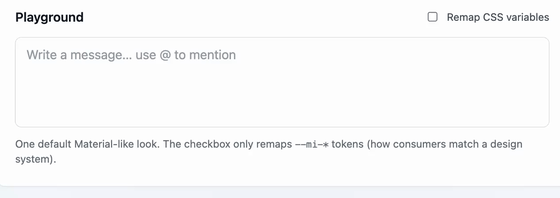

# @mojsica/react-mention-input

Contenteditable `@` mention input for React with chips and structured `MentionContentSection[]` value.



Same UX as the Angular/Vue packages (shared core). Type `@`, pick a user → a mention chip is inserted.

## Install

```bash
npm i @mojsica/react-mention-input
```

```ts
import { MentionInput } from '@mojsica/react-mention-input';
import '@mojsica/react-mention-input/styles.css';
```

**Peers:** `react`, `react-dom` — `>=18`.

## Quick start

```tsx
import { useState } from 'react';
import { MentionInput, type MentionContentSection, type MentionUser } from '@mojsica/react-mention-input';
import '@mojsica/react-mention-input/styles.css';

const [sections, setSections] = useState<MentionContentSection[]>([]);
const [users, setUsers] = useState<MentionUser[]>([]);
const [loading, setLoading] = useState(false);

async function onQuery(q: string) {
  setLoading(true);
  setUsers(await searchUsers(q));
  setLoading(false);
}

<MentionInput
  value={sections}
  onChange={setSections}
  users={users}
  loading={loading}
  onMentionQueryChange={onQuery}
/>
```

## Value model

```ts
type MentionContentSection =
  | { type: 'text'; message: string }
  | { type: 'mention'; userId: string; userName: string; email?: string };
```

## Props

| Prop | Description |
|------|-------------|
| `value` / `defaultValue` / `onChange` | Controlled or uncontrolled `MentionContentSection[]` |
| `users` | Users shown in the picker right now |
| `loading` | Loading state in the picker |
| `clientFilter` | Local name/email filter (`false` when you filter server-side) |
| `placeholder`, `disabled`, `hasError`, … | Field chrome |
| `onMentionQueryChange` | Fires as the user types after `@` |
| `onMentionSelected` | User picked from the list |
| `onMentionOpenChange` | Picker opened / closed |

Import styles once: `@mojsica/react-mention-input/styles.css`.

## Theming

```css
.my-panel {
  --mi-editor-bg: var(--ds-surface);
  --mi-editor-border: var(--ds-border);
  --mi-editor-radius: var(--ds-radius-md);
  --mi-mention-bg: var(--ds-color-primary-soft);
  --mi-mention-color: var(--ds-color-primary);
  --mi-mention-draft-color: var(--ds-color-primary);
  --mi-picker-bg: var(--ds-surface-elevated);
  --mi-picker-shadow: var(--ds-shadow-md);
  --mi-user-active-bg: var(--ds-surface-hover);
  --mi-avatar-size: 28px;
}
```

## Links

- [GitHub](https://github.com/mojsica/mention-input)
- [npm](https://www.npmjs.com/package/@mojsica/react-mention-input)

## License

MIT
