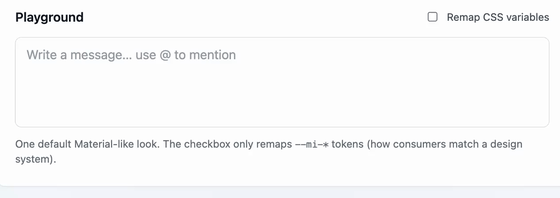

# @mojsica/vue-mention-input

Contenteditable `@` mention input for Vue 3 with chips and structured `MentionContentSection[]` value.



Same UX as the Angular/React packages (shared core). Type `@`, pick a user → a mention chip is inserted.

## Install

```bash
npm i @mojsica/vue-mention-input
```

```ts
import { MentionInput } from '@mojsica/vue-mention-input';
import '@mojsica/vue-mention-input/styles.css';
```

**Peers:** `vue` — `>=3.3`.

## Quick start

```vue
<script setup lang="ts">
import { ref } from 'vue';
import {
  MentionInput,
  type MentionContentSection,
  type MentionUser,
} from '@mojsica/vue-mention-input';
import '@mojsica/vue-mention-input/styles.css';

const sections = ref<MentionContentSection[]>([]);
const users = ref<MentionUser[]>([]);
const loading = ref(false);

async function onQuery(q: string) {
  loading.value = true;
  users.value = await searchUsers(q);
  loading.value = false;
}
</script>

<template>
  <MentionInput
    v-model="sections"
    :users="users"
    :loading="loading"
    @mention-query-change="onQuery"
  />
</template>
```

## Value model

```ts
type MentionContentSection =
  | { type: 'text'; message: string }
  | { type: 'mention'; userId: string; userName: string; email?: string };
```

## Props / events

| API | Description |
|-----|-------------|
| `v-model` | `MentionContentSection[]` |
| `users` | Users shown in the picker right now |
| `loading` | Loading state in the picker |
| `clientFilter` | Local name/email filter (`false` when you filter server-side) |
| `placeholder`, `disabled`, `hasError`, … | Field chrome |
| `@mention-query-change` | Fires as the user types after `@` |
| `@mention-selected` | User picked from the list |
| `@mention-open-change` | Picker opened / closed |

Import styles once: `@mojsica/vue-mention-input/styles.css`.

## Theming

```css
.my-panel {
  --mi-editor-bg: var(--ds-surface);
  --mi-editor-border: var(--ds-border);
  --mi-editor-radius: var(--ds-radius-md);
  --mi-mention-bg: var(--ds-color-primary-soft);
  --mi-mention-color: var(--ds-color-primary);
  --mi-mention-draft-color: var(--ds-color-primary);
  --mi-picker-bg: var(--ds-surface-elevated);
  --mi-picker-shadow: var(--ds-shadow-md);
  --mi-user-active-bg: var(--ds-surface-hover);
  --mi-avatar-size: 28px;
}
```

## Links

- [GitHub](https://github.com/mojsica/mention-input)
- [npm](https://www.npmjs.com/package/@mojsica/vue-mention-input)

## License

MIT
