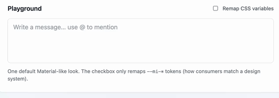

# @mojsica/angular-mention-input

Contenteditable `@` mention input for Angular with chips, a user picker, and **ControlValueAccessor** support.

Unlike textarea-only mention libs, the value is structured sections (`text` | `mention`) — useful for chat, invoice comments, and “notify users” fields.



## Install

```bash
npm i @mojsica/angular-mention-input
# or
pnpm add @mojsica/angular-mention-input
```

**Peers:** `@angular/core`, `@angular/common`, `@angular/forms` — `>=17 <21`.

## Quick start

```ts
import { FormControl, ReactiveFormsModule } from '@angular/forms';
import {
  MentionInputComponent,
  MentionContentSection,
  MentionUser,
} from '@mojsica/angular-mention-input';

users: MentionUser[] = [
  { id: '1', name: 'Ada Lovelace', email: 'ada@example.com', avatarUrl: '…' },
];

sections = new FormControl<MentionContentSection[]>([], { nonNullable: true });
```

```html
<lib-mention-input
  [formControl]="sections"
  [users]="users"
  [loading]="loading"
  (mentionQueryChange)="onQuery($event)"
  (mentionSelected)="onSelected($event)"
  (mentionOpenChange)="onOpen($event)"
/>
```

## Value model

```ts
type MentionContentSection =
  | { type: 'text'; message: string }
  | { type: 'mention'; userId: string; userName: string; email?: string };
```

## Inputs / outputs

| API | Description |
|-----|-------------|
| `[users]` | Users shown in the picker right now |
| `[loading]` | Shows a loading state in the picker |
| `[clientFilter]` | Local filter by name/email (set `false` when the parent filters/fetches) |
| `[placeholder]`, `[disabled]`, `[hasError]`, … | Field chrome |
| `(mentionQueryChange)` | Fires as the user types after `@` (and on open) |
| `(mentionSelected)` | User picked from the list |
| `(mentionOpenChange)` | Picker opened / closed |
| CVA | `MentionContentSection[]` via `formControl` / `ngModel` |

### Async users

The library does not call your API. Update `[users]` from `(mentionQueryChange)`:

```ts
onQuery(q: string) {
  this.loading = true;
  this.userApi.search(q).subscribe((users) => {
    this.users = users;
    this.loading = false;
  });
}
```

## Theming

One default Material-like look (plain CSS — **not** Angular Material).

Map your design-system tokens onto `--mi-*` on a parent (or `:root`):

```css
.my-panel {
  --mi-editor-bg: var(--ds-surface);
  --mi-editor-border: var(--ds-border);
  --mi-editor-radius: var(--ds-radius-md);
  --mi-mention-bg: var(--ds-color-primary-soft);
  --mi-mention-color: var(--ds-color-primary);
  --mi-mention-draft-color: var(--ds-color-primary);
  --mi-picker-bg: var(--ds-surface-elevated);
  --mi-picker-shadow: var(--ds-shadow-md);
  --mi-user-active-bg: var(--ds-surface-hover);
  --mi-avatar-size: 28px;
}
```

Stable classes for escape-hatch styling: `.mi-editor`, `.mi-mention`, `.mi-mention-draft`, `.mi-user`, …

## Local demo

From the monorepo root:

```bash
pnpm install
pnpm ng serve demo-angular
```

## License

MIT
